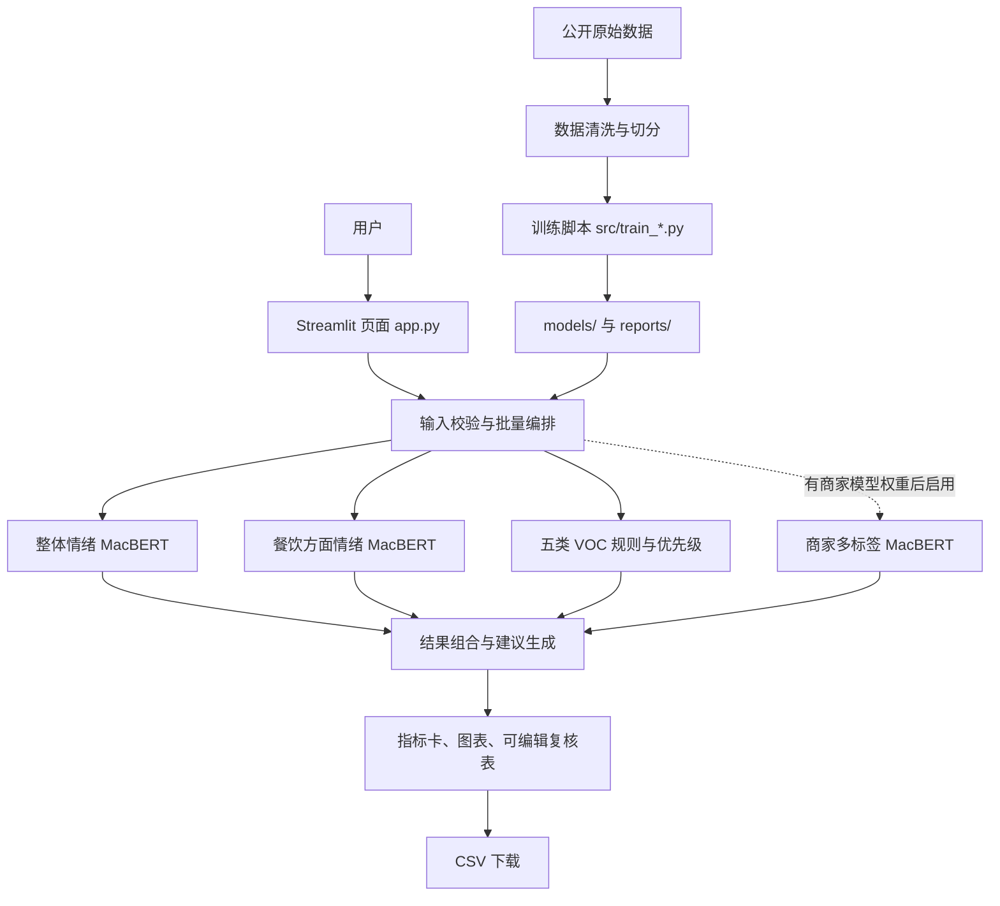

# VOC 客户声音分析原型：代码框架与设计思路报告

**报告日期：** 2026-11-10
**项目定位：** Windows 本地运行的中文 VOC（Voice of Customer，客户之声）分析原型
**当前前端地址：** http://127.0.0.1:8502
**代码根目录：** 本仓库根目录

---

## 1. 项目概述

项目把客户评论转换成可供运营和客服查看的结构化线索。现阶段包含三条相互补充的分析路径：

1. **整体情绪识别**：判断一条评论总体偏正面还是负面，使用已训练的 MacBERT 二分类模型。
2. **餐饮评论方面情绪识别**：识别评论谈到了哪些方面，并判断各方面情绪，使用在 ASAP 餐饮评论数据上微调的方面级模型。
3. **业务问题提示**：从质量、物流、退款退货、改进建议、购买意向五类词表/正则中发现线索，并生成优先级与处理建议。当前这条路径是可复核的规则提示，不是已训练的商家分类模型。

网页提供单条诊断、CSV 批量分析、汇总图表、人工复核字段和结果导出。项目目前是单机原型：Streamlit 页面与模型推理在同一个 Python 应用中，没有独立 REST API、数据库、账户权限或后台任务队列。

## 2. 总体架构



### 2.1 运行时架构

- `app.py` 负责页面绘制、读取用户输入、调用各模型/规则、组合结果和提供下载。
- 模型结构及加载代码在 `src/`。权重、分词器和元信息从 `models/` 读取。
- 数据准备、训练、阈值选择和离线评估由命令行脚本完成；页面启动时不在线训练。
- Streamlit 在本机提供网页服务。目前 VOC 版本固定使用 `127.0.0.1:8502`，因为 `8501` 被电脑上的另一个项目占用。
- 页面没有把客户输入保存到数据库；批量编辑状态保存在当前 Streamlit 会话中，下载 CSV 后由使用者留存。

## 3. 代码目录与职责

| 路径 | 职责 |
|---|---|
| `app.py` | Streamlit 前端、单条/批量推理编排、结果展示、人工复核和下载 |
| `src/prepare_data.py` | 商品评论清洗、去重、分层切分为 train/valid/test |
| `src/train_baseline.py` | 字符级 TF-IDF + Logistic Regression 基线训练与评估 |
| `src/train_macbert.py` | 整体二分类情绪模型微调、验证集选模和测试集评估 |
| `src/predict.py` | 命令行单条情绪预测 |
| `src/asap_model.py` | ASAP 18 方面模型结构、标签映射和模型加载 |
| `src/train_asap_absa.py` | 方面情绪训练、类别加权、验证集选模和测试评估 |
| `src/rule_triage.py` | 五类业务关键词规则、高风险优先级、动作建议和方面建议 |
| `src/voc_model.py` | 商家 VOC 五标签 MacBERT 结构及加载逻辑 |
| `src/train_voc_multilabel.py` | 商家授权标注数据多标签训练、验证集阈值调优、测试集评估 |
| `data/raw/` | 原始公开数据与来源材料 |
| `data/processed/` | 整体情绪模型使用的 train/valid/test 文件 |
| `data/annotation_template.csv` | 商家反馈人工标注模板 |
| `data/label_schema.csv` | VOC 标签定义草案 |
| `data/sample_voc_test.csv` | 24 条合成测试评论，便于试用批量页面 |
| `models/macbert/` | 已训练整体情绪模型、Tokenizer 和配置 |
| `models/asap_macbert/` | 已训练餐饮方面模型、Tokenizer 和元信息 |
| `models/voc_multilabel/` | 商家 VOC 分类器预期输出位置；当前还没有商家训练权重 |
| `reports/` | 模型指标、对比与业务准备度说明 |

## 4. 分析链路与页面流程

### 4.1 单条诊断

用户在“单条诊断”输入反馈并点击分析。页面执行以下步骤：

1. 对文本做分词与截断，然后调用整体情绪模型输出正/负判断和概率。
2. 用规则引擎匹配质量、物流、退款退货、建议、购买意向关键词。
3. 计算建议优先级：风险词触发高优先级；质量或退款类一般为中；其他规则命中默认为低。
4. 若餐饮方面模型可用，输出达到阈值的方面及正/中/负情绪，并根据负面方面生成运营建议。
5. 若存在商家 VOC 模型权重，则额外输出模型标签与置信度；目前缺少该权重时，页面会展示规则提示和训练说明。
6. 页面将情绪概率、类别来源、处理建议与复核提醒分区展示。

### 4.2 CSV 批量分析

1. 用户上传 CSV；优先识别 `review`、`review_text`、`text`、`反馈文本` 列，否则手动选择文本列。
2. 过滤空文本，对有效记录批量执行情绪、方面、规则和可选商家模型推理。
3. 在结果表新增情绪判断/置信度、业务提示类别、优先级、建议动作、餐饮方面分析、运营建议、人工确认类别和处理状态。
4. 汇总分析条数、负向反馈、业务规则命中数、高优先级数；展示情绪分布、业务类别分布和餐饮负面方面排行。
5. 用户可编辑“人工确认类别”和“处理状态”；页面前 1,000 条可编辑，下载文件覆盖全量分析结果。
6. 分析结果存入当前 Streamlit session state，以避免表格交互触发页面 rerun 后结果消失。

## 5. 模型设计

### 5.1 整体情绪模型

- **底座：** `hfl/chinese-macbert-base`。
- **任务：** 每条评论二分类（负向、正向）。
- **数据：** `online_shopping_10_cats` 中文商品评论，清洗去重后 62,767 条；按类别和情绪组合分层，train 50,213、valid 6,277、test 6,277。
- **训练：** AdamW、学习率 `2e-5`、FP16、梯度累积；每轮在验证集计算 Macro-F1，保存最佳模型，再报告独立测试集结果。
- **基线：** 字符 1–3 gram TF-IDF + Logistic Regression，用来比较深度模型增益。
- **测试结果：** MacBERT Accuracy 0.9513、Macro-F1 0.9512；TF-IDF 基线 Macro-F1 0.9337。
- **边界：** 这是公开商品评论的正负情绪能力，不代表投诉分类、严重程度、购买意向或退款识别效果。

### 5.2 餐饮方面情绪模型（ABSA）

- **数据：** Meituan-Dianping ASAP 官方 train/dev/test 划分，36,850 / 4,940 / 4,940 条。
- **任务：** 对 18 个方面分别预测“未提及、负向、中性、正向”四种状态；不是只做整句情绪分类。
- **输出方面：** 到店交通、商圈位置、店铺是否好找、排队等位、服务态度、停车便利、服务效率、价格水平、性价比、优惠活动、装修、噪音、空间、卫生、分量、口味、菜品外观、菜品推荐度。
- **结构：** MacBERT 编码评论，取 `[CLS]` 表示，dropout 后接一个输出 `18 × 4` 的分类层。
- **训练策略：** 各方面四类标签加权交叉熵；按验证集“方面-情绪联合 F1”选最佳 checkpoint；使用官方测试集最终报告。
- **测试结果：** 方面提及 F1 0.8615；方面-情绪联合 F1 0.7402；已标注方面上的情绪 Macro-F1 0.7627。
- **边界：** 该语料是餐饮评论，不覆盖商品质量、退款、购买意向和物流配送标签。跨行业结果需要独立验证。

### 5.3 商家 VOC 多标签模型（待真实数据训练）

- **预期标签：** 质量问题、物流问题、退款退货、改进建议、购买意向。单条反馈可以同时有多个标签。
- **结构：** MacBERT 编码器后接五维线性层，使用 `BCEWithLogitsLoss` 训练，每个标签独立 sigmoid 概率。
- **不平衡处理：** 根据训练集正负例比例计算 `pos_weight`；每类在验证集分别搜索阈值；使用 Macro-F1、Micro-F1、Exact-match 和逐类指标评估。
- **当前状态：** 训练脚本已准备，但没有商家授权标注数据和已训练权重。因此网页当前五类主要来自规则，不能把规则命中说成模型置信度。
- **训练数据要求：** 将 `review_text` 和 `issue_types` 列放入互不重叠的训练、验证、测试 CSV；标签用分号分隔；建议按时间或客户切分，避免同一客户/重复评论泄漏。每类训练集至少 20 条正例只是脚本最低门槛，不代表足够获得稳定效果。

## 6. 规则引擎与运营建议

`src/rule_triage.py` 通过中文正则词表提示五类问题，并将类别映射到建议动作，例如质量问题转售后核查，物流问题核对配送记录，购买意向转销售跟进。高风险词（如异物、食物中毒、漏电、起火、受伤等）会提升优先级；退款和质量投诉通常进入中优先级。

规则适合在缺少标注数据时先做可解释的线索发现，但存在否定、反讽、上下文和新表达识别不足。举例来说，“没有漏水”也可能命中“漏水”规则。因此页面将其标为规则提示并要求人工复核，不应作为自动退款、赔偿或风控决策的唯一依据。

## 7. 数据与标签治理

- 商品评论与 ASAP 数据的来源、数据格式和授权注意事项记录在 `data/DATA_SOURCE.md`。
- 商品评论镜像页没有清晰的商业再利用授权；在对外发布或商业化前应核实上游许可与衍生权利。
- ASAP 仓库提供 Apache-2.0 许可文件，但评论来自第三方平台；仍需单独核实评论内容及衍生权重的商业适用范围。
- 测试 CSV 中 `expected_*` 列是合成样例的参考标签，不是生产真值；正式评估应以人工双人复核的行业数据为准。
- **待整理项：** 当前 `src/voc_model.py` 与训练脚本使用五类标签；`data/label_schema.csv` 还包含 `usage_question`、`positive_feedback`、`other` 等额外类别；`annotation_template.csv` 还有严重程度、购买意向等字段。开始商家数据标注前，需统一标签表、模板、规则标签和模型标签，明确多标签边界、严重级别及未知/其他定义。

## 8. 当前限制与风险

1. 本地原型没有持久化数据库、账号权限、审计日志、任务队列或多租户隔离。
2. CSV 批量推理在页面请求中同步执行；大文件可能占用较长时间和显存，表格交互上限为 1,000 行，但下载结果保留全量。
3. 情绪分类指标来自公开商品评论，行业分布与真实客服工单可能不同；需用目标商家数据做外部验证。
4. 餐饮方面模型可能对非餐饮评论产生看似合理但不适用的方面输出，页面应提醒用户检查场景。
5. 五类业务标签目前未经过训练集/独立测试集评估，规则召回与误报水平未知。
6. 公开评论及模型衍生物可能存在许可限制；商业试点应优先使用客户授权且脱敏的数据。
7. CSV 可能含个人信息；当前页面没有自动脱敏，上传前应去除姓名、电话、订单号、地址等信息。

## 9. 运行与复现

### 启动 VOC 前端

```powershell
conda activate nlp_gpu
cd "$env:USERPROFILE\Desktop\VOC助手原型"
python -m streamlit run app.py --server.address 127.0.0.1 --server.port 8502
```

浏览器访问 `http://127.0.0.1:8502`。当前环境使用 RTX 5060 Laptop 8 GB 显存；情绪与方面模型可以在 GPU 上推理，CPU 也可运行但速度较慢。

### 复训整体情绪模型

```powershell
python src/prepare_data.py
python src/train_baseline.py
python src/train_macbert.py --epochs 3 --batch-size 8 --grad-accum 2 --max-length 128
```

### 复训 ASAP 方面情绪模型

```powershell
python src/train_asap_absa.py --epochs 3 --batch-size 4 --grad-accum 2 --max-length 384
```

### 训练商家 VOC 模型

先统一标签口径并准备商家授权数据，再运行：

```powershell
python src/train_voc_multilabel.py --train-csv data/merchant_train.csv --dev-csv data/merchant_dev.csv --test-csv data/merchant_test.csv
```

不要将训练集指标当作泛化效果；以独立测试集结果和人工审核为准。

## 10. 建议迭代路线

### 阶段一：完善标注规范

统一五类 VOC 标签与 `label_schema.csv`、标注模板、规则表。增加边界案例、否定句、复合诉求和多标签说明；对高风险与退款类明确优先级标准。

### 阶段二：采集少量试点标注数据

在客户授权、脱敏后先抽取代表性工单/评论，双人标注并计算一致性；按时间或客户划分 train/dev/test。优先保证每个类别包含多种表达，而非只追求总样本量。

### 阶段三：训练与错误分析

用验证集调阈值，重点审查质量安全、退款和购买意向的误报/漏报；检查不同渠道、产品类别和时间切片的效果。保留规则引擎作为兜底，但在 UI 明确展示预测来源和置信度。

### 阶段四：形成运营闭环

在获得授权后接入工单/订单元数据，将每条反馈关联产品、渠道、时间、处理结果和后续满意度；通过趋势、主题聚类、问题率和转化/退款指标评估实际业务价值。此阶段需要数据库、权限、审计和批处理等生产化组件。

## 11. 关键结论

当前原型已经完成整体情绪模型和餐饮方面情绪模型的训练与页面集成，也完成五类可解释规则提示及批量复核导出流程。它适合演示、验证交互和在相近数据上探索；尚不能被描述为已经训练好的通用商业 VOC 分类平台。要实现可靠的行业问题分类，关键工作是统一标签定义、取得授权数据、完成独立测试和根据人工反馈迭代。

## 参考文件

- `README.md`：安装、训练和运行命令
- `data/DATA_SOURCE.md`：数据来源与授权注意事项
- `reports/macbert_metrics.json`：整体情绪测试指标
- `reports/asap_metrics.json`：餐饮方面情绪测试指标
- `reports/comparison.md`：基线与 MacBERT 对比
- `reports/business_readiness.md`：当前业务范围简报
